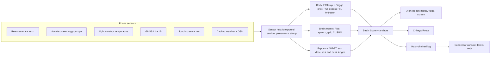
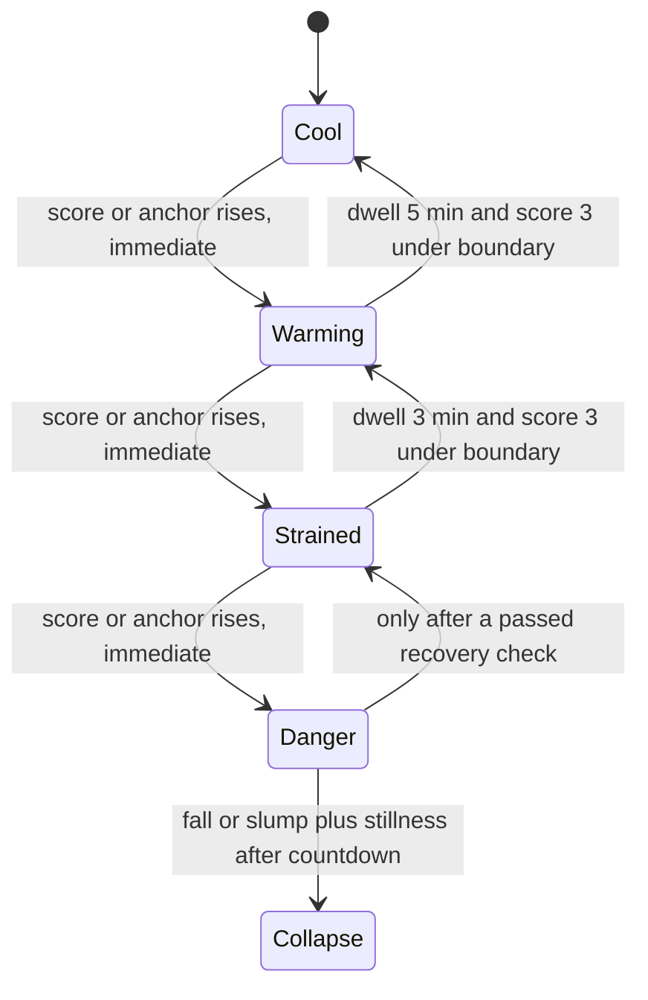
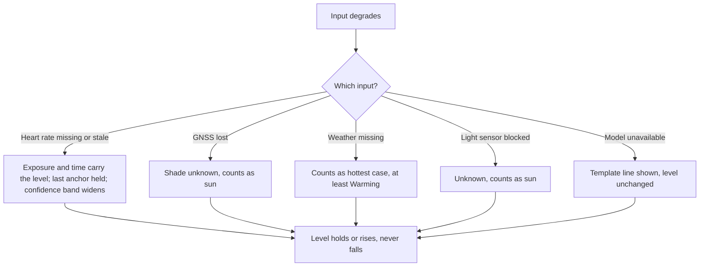
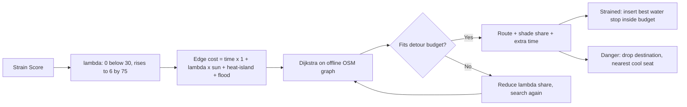

<div align="center">

# THAKAAN (थकान)

**Garmi se pehle, Thakaan.** *(Before the heat gets you.)*

*On-device, offline heat-strain guardian for outdoor workers: it senses body, brain and sun with the phone they already carry, and routes them to shade and water before heat takes them down*

**iQOO Hackathon 2026 · Grand Finale, Bengaluru · Track: HealthTech · iQOO 15 (Snapdragon 8 Elite Gen 5)**

**Team Chole Bhature** · 📄 [**Pitch deck (PDF, 15 slides)**](Thakaan%20—%20iQOO%20Hackathon%202026.pdf)

</div>

---

## Overview

Heat stroke attacks judgement before the body gives up, so the people most exposed keep working until they collapse. City heat alerts say nothing about one person. Wearables cost too much and are uncomfortable in humid heat. Platform rest points exist, but workers skip them because rest costs earnings.

Thakaan turns the phone a delivery rider, construction worker or street vendor already carries into a personal heat-strain guardian. It fuses three kinds of evidence into **one Strain Score**, then acts on it:

- **A nurse watches the body:** fingertip pulse, a hidden core-temperature *trend*, hydration.
- **A teacher watches the mind:** hand tremor, tapping speed, a spoken digit code, gait.
- **A weather reporter watches the street:** sun, shade, wet-bulb heat, how long since the last rest.

All three report to a **coach**, the Thakaan Strain Score (TSS). The coach decides what to say, in which language, and where to send the worker: **Chhaya Route**, a router whose detour budget is set by the rider's own body. At Cool you get the fastest route. At Strained you get a shadier route and a water stop, with the extra minutes shown. At Danger you are sent to the nearest cool seat.

The system answers seven questions, in order, before it says a word to the worker:

1. What is the sun and the street doing to this person right now? *(always available, the score never goes blank)*
2. What is the heart saying, and how recent and clean is that reading?
3. Is the brain slowing down compared with this worker's own normal?
4. What do the worker's own symptoms say?
5. What did we fail to see, and does missing information ever lower the level? *(never)*
6. What is the one action, how long does it take, and in which language?
7. Where is the nearest shade and water that fits inside the detour budget?

## Features

| Capability | Description | State |
|---|---|---|
| Strain Score with anchored levels | Cool / Warming / Strained / Danger from exposure, body, brain and symptoms; the shown level is the highest that the score *or any anchor* supports | Built, seen on phone |
| Core-temperature trend | Personalised ECTemp Kalman filter on a Gagge two-node prior; never shown as a number | Built, 7/7 reference vectors seen on phone |
| Fingertip pulse | Rear camera + torch PPG with quality gates and retry prompts | Built; gates uncalibrated, no accepted capture confirmed against a reference |
| Brain battery | Tremor hold, Fitts tapping, spoken digit code, symptom tap, 3-min PVT-B to confirm a flag | Built; Fitts seen with real taps |
| Liljegren WBGT | `lwbgt` C library through NDK/JNI; never the ACSM87 formula by day | Built, library seen on phone |
| Chhaya Route | Own Dijkstra over an OSM graph, strain-aware cost, forced water stop, flood closures | Built, offline routing seen on phone |
| Shade map | Precomputed shadows from OSM footprints, plus an opt-in satellite-height layer on an H3 grid | Built; computed, not measured |
| Fail-safe invariant | Losing or degrading information can never lower the level; property-tested | Built, 6 live Safety checks seen on phone |
| Provenance chips | Every value is REAL, REPLAY or SIMULATED; replay never shows as REAL | Built, seen on Home and Chhaya |
| Hash-chained exposure log | Keystore-signed proof-of-exposure log, verified in the supervisor console | Built, tamper detection seen on phone |
| Guarded LLM phrasing | Gemma 4 E2B phrases what the engine decided, from a fixed action set; template lines are the fallback | Built, loads on GPU |
| Five languages | Spoken alerts in Hindi, Kannada, Tamil, Telugu and English with offline voices | Built; voices installed, wording needs native-speaker review |
| Collapse detection | Fall or slump plus stillness, with a spoken "say haan" countdown first | Built, countdown seen on phone |
| Supervisor console | Local web page; levels and coarse reasons only, never raw heart rate or voice | Built, verifier cross-checked |
| Crew mesh | Bluetooth LE flood reports and buddy alerts, no internet | Built |

---

## Problem statement

Riding is light work (about 1.5 to 2.5 MET) and the wind keeps the body cool while moving. At a red light over hot tarmac the wind vanishes and the body heats within seconds. Tools built for soldiers and labourers miss this pattern.

| Need | What Thakaan delivers |
|---|---|
| A personal heat signal, not a city alert | A per-worker Strain Score from that worker's own body, brain and exposure |
| No wearable | Phone only: rear camera + torch, accelerometer, light sensor, GNSS, touchscreen, microphone |
| Works where the signal is bad | The app declares **no `INTERNET` permission**; routing works in airplane mode |
| An action that fits the job | One action per alert, with its time cost; detours capped by current strain; the job's navigation never blocked |
| The worker's language | Spoken in Kannada, Hindi, Tamil, Telugu or English |
| Privacy from the employer | Raw physiology never leaves the phone; supervisors see levels and coarse reasons only |

---

## Why this is different: five claims

1. **The route is priced by the body.** Chhaya's cost is `time × (1 + λ(TSS) × sun)`, and λ is *exactly zero* below TSS 30. At Cool the route **is** the fastest route; a rider is never made to spend time they did not need to spend.
2. **We act before the estimate fails.** Core-temperature estimates miss almost every hot reading above about 39 °C, which is where heat stroke begins. So every action fires at **38.5 °C or below** (38.0 °C before acclimatisation), and an independent rest-heart-rate rule (sustained above 90 to 100 bpm) backs it up.
3. **Missing information never lowers the level.** Stale heart rate holds its last anchor. Lost GNSS counts as sun. Missing weather counts as the hottest case. A blocked light sensor holds or raises the level. This is a property test, and each guard switched off makes the test fail.
4. **Every number says where it came from.** REAL, REPLAY or SIMULATED is stamped at the sensor hub and inherited by anything computed from it. A strain score driven by replayed heart rate is shown as REPLAY.
5. **The model never decides.** Gemma only phrases what the risk engine already decided. A model line is accepted only if it states the engine's own minute figure, adds no other numbers, quotes no temperature or pulse, and contains no reassurance. Otherwise the template line is shown. This guard was seen rejecting a Gemma line on the phone.

A sixth property ties them together: **a check that cannot fail proves nothing.** Every safety check has a hidden guard switch that must turn it red. This caught a real defect: the "missing weather" guard turned nothing red when flipped, so check 6 was added.

---

## Architecture

### Sensors to actions



### The four levels, and what moves between them



### Fail-safe: degraded information holds or raises



### Chhaya Route: how strain sets the detour



---

## Deep Dive: The Layers

### Body: ECTemp on a physics prior

A published sigmoid maps core temperature to expected heart rate; the Kalman filter corrects its estimate with each clean reading.

$$HR_{exp} = A + \frac{K - A}{\left(1 + 0.06\,e^{-0.89(\hat{CT}_t - 37.84)}\right)^{1/0.07}}$$

$$k_t = \frac{\hat{v}_t\,m_t}{m_t^2\,\hat{v}_t + R_t}, \quad CT_t = \hat{CT}_t + k_t\,(HR_t - HR_{exp}), \quad v_t = (1 - k_t m_t)\,\hat{v}_t$$

Q = 0.000484, R = 356.4544, and a reading is rejected when its normalised innovation squared exceeds 3.84. A (floor) is learned from the worker's lowest sustained resting heart rate; K (ceiling) comes from age (HRmax = 208 − 0.7 × age, Tanaka).

Between readings, a Gagge two-node thermoregulation model steps the estimate forward. It may **cool** the estimate by at most 0.002 °C per minute and **warm** it by up to 0.05 °C per minute, so a wrong prior can never talk the level down quickly. The reference vectors assume a reading every minute, but Thakaan gets them at stops, so the variance must **grow, never shrink,** across gaps. That has its own tests, including a 12-minute gap and an injected 160 bpm spike at rest.

### Body: heart-rate discipline

HR is compared only at the same state and the same time-since-stop, and the first 30 s after a posture change are down-weighted. RMSSD is **never** computed from under 60 s of clean pulse. Under heat the pulse-derived variability reads high (vasodilation), so it is flagged heat-affected rather than counted as good recovery.

### Brain: own normal on own phone

Every brain score is a robust z-score (median and MAD) against the same worker, the same phone, the same placement and the same time-of-day bucket. With no baseline there is no judgement. Change detection is a one-sided CUSUM, a filling bucket where one slow test does not alarm but five mildly slow ones do:

$$C^{+}_t = \max\left(0,\; C^{+}_{t-1} + x_t - \mu_0 - k\right), \qquad k = 0.5\sigma, \quad \text{alarm at } h = 4\text{ to }5\sigma$$

Confirmation needs **independent families** of evidence: motion, touch, voice, navigation and symptoms. Three versions of the same signal do not count as three. Two families flagged with high exposure force at least Strained.

### Exposure: the backbone

WBGT comes from the Liljegren model (`lwbgt` through the NDK), never the ACSM87 formula by day. Sun or shade comes from the light and colour-temperature sensors (direct sun is about 5,000 to 5,500 K, open shade about 7,500 to 10,000 K), cross-checked by GNSS sky view and the sun's azimuth. The phone's own body is **never** used as a globe thermometer. Missing weather scores as the most extreme heat, so no real reading can be more pessimistic than missing data.

### The Strain Score

$$TSS = 100\cdot\sigma\big(w_E\,E + w_B\,B\,q + w_N\,N + w_S\,S + b\big)$$

E is the exposure prior, B body strain, q the freshness and quality of the last heart-rate reading, N brain impairment, S symptoms. All four weights are 3.0 and the bias is −3.0, **fixed by hand and not yet calibrated**, so treat TSS as an ordered score and the *anchored level* as the thing to trust.

| Level | TSS | Anchors that force it (examples) | Default action |
|---|---|---|---|
| Cool | 0 to 29 | None | Normal routing |
| Warming | 30 to 54 | WBGT above the action limit; weather unknown; resting HR above 90 | Nudge to drink; small detours allowed |
| Strained | 55 to 79 | Core trend at 38.5 °C (38.0 °C unacclimatised); hydration deficit above 2%; resting HR above 100 | Water stop routed next; full check at next stop |
| Danger | 80 to 100 | Two brain families flagged; perfusion collapse; severe symptom; never waits for 39 °C | Stop now: nearest shade, alert contact and supervisor, cooling coach |
| Collapse | N7 event | Fall or slump plus stillness after the countdown | Siren, bystander screen, SMS preview |

A level rises immediately but falls only after a dwell time. Anchors latch for 10 minutes. **Danger never auto-clears:** only a passed recovery check steps it down once.

### Chhaya Route

$$C_e = t_e\,\big(1 + \lambda(TSS)\cdot S_e(h)\big) + \mu\,H_e + F_e$$

t is travel time, S the sun-exposure fraction at hour h, H the heat-island penalty, F the flood term (very large, effectively closing the road). The router finds the largest share of λ whose route still fits the detour budget: Warming allows 10% of the fastest time (1 to 5 min), Strained allows 25% (3 to 10 min). Every route shows its price, for example "+2 min, 70% shade", with the fastest route dashed for comparison.

Shade is **computed ahead of time on the laptop** by ray-casting sun position against OSM building footprints for each road segment and each 30 minutes of the day. About 95% of OSM building heights are guessed (3 storeys × 3.2 m), so those segments are marked low-confidence and pushed halfway toward full sun. The screen says so on every route.

### The Hash-chained exposure log

Each entry (shift, time, sun dose, rests, peak level) stores the SHA-256 of the entry before it, and the log is signed with an ECDSA P-256 key held in the Android Keystore (hardware-backed, StrongBox present on the iQOO 15). The console verifies it in the browser and shows "Chain OK" or "Chain BROKEN". **A valid chain proves entries were not edited after they were recorded, not that the observation was true.**

### Air and rain (separate from the strain level)

$$Dose_{PM2.5} = \sum C \times V_E \times \Delta t$$

C is a modelled area PM2.5 value (Copernicus CAMS via Open-Meteo, about an 11 km grid, labelled as modelled, never as the worker's own air). V_E is minute ventilation estimated from heart rate with the Greenwald et al. (2019) pooled power model. Flood reports (one tap plus a fresh photo) close every road segment within 30 m for 3 hours. Neither layer changes the strain level.

---

## Evidence: what the phone has shown

All of the following are recorded in [`docs/DEVICE_RESULTS.md`](docs/DEVICE_RESULTS.md) from runs on the iQOO 15.

| Result | Value |
|---|---|
| ECTemp reference vectors | **7/7 pass** on the phone (quadratic reference model matches at 1e-9) |
| Safety checks | 5/5 PASS seen on the phone, guards 1 to 5 each turned red when switched off; check 6 added afterward and unit-tested |
| Safety property test | **508 laptop test cases pass**; each guard off makes the property fail |
| Camera stream | Steady **30 fps** (mean 33.4 ms, one dropped frame in 743) |
| Offline operation | No `INTERNET` permission (checked with `dumpsys package`); Chhaya re-routes instantly with **airplane mode on** |
| Chhaya shade | 38% and 49% shade on two test routes; 9 to 35% of each route on guessed heights |
| Hash-chain tamper detection | Hardware-backed key; a changed byte and a cut-off last entry both caught |
| Gemma explainer | Loads on the GPU in well under 45 s; wording guard seen rejecting a line |
| Chest-pocket pulse | Two real recordings read 70.6 and 73.2 against a counted pulse of 70 |
| Provenance | Replay 20x shows the REPLAY chip on Home and Chhaya |


---

## Privacy by construction

| Data | Stored | Leaves the phone? |
|---|---|---|
| Camera frames, audio clips | RAM only, discarded after inference | Never |
| HR, HRV, core-temperature trend, brain scores, symptoms | App-private storage | Never |
| Strain level and alerts | On device | Only to contacts or a supervisor the worker approved |
| Flood reports | On device | Over the Bluetooth LE crew mesh, anonymous |
| Proof-of-exposure log | On device, hash-chained, Keystore-signed | Only when the worker exports it |

`ConsoleSafe` maps driver codes to category labels on the phone, so a driver text that quoted a number or symptom cannot leak. The console never shows per-minute scores or raw signals, so the data cannot be used to rate or deactivate workers. Declared permissions: location, camera, microphone, vibrate, notifications and Bluetooth only.

---

## Tech Stack

| Area | Technology |
|---|---|
| Language and UI | Kotlin, Jetpack Compose (Material 3), coroutines and Flow |
| Target | iQOO 15, Android 16 (`compileSdk` 36, `minSdk` 33), arm64-v8a, OriginOS 6 |
| On-device models | LiteRT 1.4 with QNN delegate (Hexagon NPU), LiteRT GPU, MediaPipe Face Landmarker |
| Language model | Gemma 4 E2B through LiteRT-LM on the Adreno GPU |
| Speech | Vosk offline digit grammar (en-IN, hi); Whisper-tiny as an advisory lab second opinion; Android offline TextToSpeech |
| Native | `lwbgt` (Liljegren WBGT) through the NDK and JNI, built with CMake |
| Routing and map data | Own Dijkstra over an OpenStreetMap-derived graph; shade tables precomputed on the laptop (H3 grid for the satellite-height layer) |
| Weather and air | Cached Open-Meteo forecast and CAMS PM2.5 (no network at demo time) |
| Console | Plain HTML + JavaScript, SHA-256 and ECDSA P-256 through WebCrypto, served locally |
| Tooling | Python (asset fetchers, shade precompute, model push scripts), `adb`, Office Kit mirror |

---

## Project Structure

```
app/src/main/java/com/thakaan/
  sensorhub/    foreground service, provenance stamping, recorder and replay
  inference/    InferenceEngine seam: QNN, GPU and CPU back ends
  ppg/          fingertip PPG pipeline and quality gates
  body/         ECTemp, Gagge/PHS prior, hydration, excess HR, sit-to-stand
  brain/        tremor, Fitts, CUSUM, gait, brief PVT, symptoms
  face/         face rPPG, fatigue signals, frame guidance (display only)
  speech/       digit-code recogniser and speech lab
  exposure/     E1 to E18: light, WBGT, sun dose, rest and drink ledgers, sky view
  motion/       activity, mode and stop detection, collapse countdown
  risk/         Strain Score, anchored levels, alert ladder, safety invariant
  coach/        cooling coach
  chhaya/       road graph, shade layers, strain-aware router, flood store
  mesh/         Bluetooth LE crew mesh for flood reports and buddy alerts
  shift/        shift runtime, shift report, quick-check plan
  audit/        hash-chained exposure log and signing
  ml/           small learned shadow models
  settings/     onboarding profile and daily check-in
  ui/           Compose screens
console/        local supervisor console and chain verifier
assets/         ectemp_vectors.json, OSM graph, shade tables, weather cache, lwbgt
tools/          asset fetchers, shade precompute, model push, console server
docs/           product bibles, build map, ticket tracker, device results
```

---

## Installation

```bash
git clone <this-repo-url> thakaan
cd thakaan
```

Set `JAVA_HOME` to Android Studio's bundled `jbr`, connect the iQOO 15 with USB debugging on, then:

```bash
./gradlew :app:installDebug
```

The debug build also compiles the native WBGT library for arm64.

**Large assets are not committed.** Model files, OSM extracts and API keys are git-ignored. Stage them through Office Kit or `adb`, and see [`docs/ASSETS.md`](docs/ASSETS.md):

```bash
tools/push_models.sh                                     # push Gemma, Vosk and Whisper models to the phone
python tools/verify_assets.py --adb <path to adb>        # expect no PROBLEM lines
```

**OriginOS kills background work.** Before a shift: battery set to **Unrestricted**, app **locked in Recents**, autostart allowed, location set to "Allow all the time".

**Supervisor console:**

```bash
python -I tools/console/serve.py
```

On the phone tap *Copy status for console*, then paste into the console page. The console shows levels and coarse reasons only.

---

## Testing

```bash
./gradlew :app:testDebugUnitTest      # laptop unit tests, including the safety property test
node console/verify_test.js           # console chain verifier against Kotlin-generated fixtures
```

On the phone, open **Diagnostics**:

- **ECTemp 7/7** vectors run on the device.
- **Safety checks** run six live scenarios with PASS/FAIL; each has a hidden guard switch that must turn its row red.
- **Models on this phone** shows each model's back end. A session that loads without throwing may still be on the CPU, so Diagnostics reads the delegated-ops count ("N/N ops on NPU") instead of trusting a successful load.

Device-only checks are tracked in [`docs/PHONE_CHECKLIST.md`](docs/PHONE_CHECKLIST.md).

---

## Demo

Everything on the path works with the phone in **airplane mode**, and "replay" is said aloud whenever the chip says REPLAY.

1. **Set the scene.** A delivery rider, noon, 41 °C. Home screen, REAL chip.
2. **Replay the shift.** Replay 20x: the gauge goes Cool, Warming, Strained, with the forecast line and a REPLAY chip.
3. **The alert.** One action, in the worker's language, with its time cost. Switch Hindi to Kannada.
4. **Chhaya Route.** Fastest at Cool; a shadier route plus water stop at Strained; the nearest cool seat at Danger.
5. **Quick check.** A teammate who has never seen it does the 90-second check: finger, hold still, tap, how do you feel.
6. **Console.** Copy status, paste, see levels and coarse reasons only. Change one byte in the log: "Chain BROKEN".
7. **Safety checks.** 6/6 PASS, flip one guard, its row turns red.
8. **Limits.** Shade is computed, the level is an estimate, not a medical device, ECTemp needs a licence.

Full script: [`docs/DEMO_SCRIPT.md`](docs/DEMO_SCRIPT.md).

---

## Team

**Team Chole Bhature** (Atharv Phutela, Bhavya Garg, Bhaskar Kumar Arya) built Thakaan in 48 hours at the iQOO Hackathon 2026 Grand Finale, Bengaluru, 9 to 11 October. The pitch deck is [`Thakaan — iQOO Hackathon 2026.pdf`](Thakaan%20—%20iQOO%20Hackathon%202026.pdf).

Ownership by role (names are not yet assigned to roles in [`docs/DECISIONS.md`](docs/DECISIONS.md)):

| Role | Owns |
|---|---|
| **A, Body** | Fingertip PPG, ECTemp, heat-balance prior, body vectors |
| **B, Brain + World** | Motion, environment, brain battery, Chhaya Route |
| **C, Systems + Demo** | Skeleton, risk engine, safety checks, Office Kit, console, metrics, demo |

---

## Glossary

| Term | Meaning |
|---|---|
| TSS | Thakaan Strain Score, 0 to 100 |
| Chhaya Route | Strain-aware routing to shade and water |
| ECTemp | US Army Kalman-filter model that estimates a core-temperature trend from heart rate |
| Gagge two-node model | Core and skin heat-balance model of the body |
| WBGT | Wet-bulb globe temperature, a heat-stress index; Liljegren method here |
| PPG | Photoplethysmography: pulse from light through a fingertip |
| RMSSD | Beat-to-beat variability; never from under 60 s of clean pulse |
| PSI | Physiological Strain Index, 0 to 10 |
| CUSUM | Cumulative-sum change detection: small repeated slowdowns fill a bucket until it overflows |
| Fitts tapping | Tapping between two targets to test motor coordination, scored in bits/s |
| PVT-B | Brief psychomotor vigilance test |
| Independent families | Different kinds of brain evidence that must agree before a flag counts |
| Provenance | REAL, REPLAY or SIMULATED label on every reading |
| Safety invariant | Losing or degrading information may never lower the strain level |
| Guard switch | A hidden switch that disables one safety guard so its check must turn red |
| Shadow model | A learned model that runs beside the rule-based path and never decides a level |
| Hash chain | Each log entry stores a fingerprint of the previous one, so editing history is detectable |
| NIS | Normalised innovation squared: the outlier test for filter observations (gate 3.84) |

---

## Documentation

- [`Thakaan — iQOO Hackathon 2026.pdf`](Thakaan%20—%20iQOO%20Hackathon%202026.pdf): the 15-slide pitch deck. The Bible maps each slide to its section and lists where the deck's wording differs from the code
- [`docs/Thakaan — Product Bible.md`](docs/Thakaan%20—%20Product%20Bible.md): intent, vectors, formulas, UX, demo and privacy (source of truth on *why*)
- [`docs/Thakaan — Product Bible, Simplified.md`](docs/Thakaan%20—%20Product%20Bible%2C%20Simplified.md): the same product in plain words
- [`docs/Thakaan — Build Map v1.md`](docs/Thakaan%20—%20Build%20Map%20v1.md): 65 tickets in strict dependency order (source of truth on *execution*)
- [`docs/TICKETS.md`](docs/TICKETS.md): live checklist
- [`docs/Thakaan-Architecture.html`](docs/Thakaan-Architecture.html): the architecture diagram

---


<div align="center">

**Thakaan** · iQOO Hackathon 2026 Grand Finale · HealthTech

</div>
